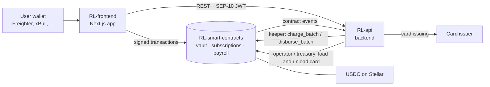

# Rubbi

**Payment automation on Stellar: a USDC wallet, a virtual card, recurring subscriptions and payroll, all from one dashboard.**

Built for people and small teams in Nigeria who want to hold dollars, pay bills on time and run payroll without spreadsheets or bank delays.

🧪 **Status:** live on Stellar **testnet** · open source under the **MIT** license · not yet independently audited

---

## What Rubbi does

| Feature | How it works |
|---|---|
| **Rubbi wallet** | Deposit USDC into the vault contract and withdraw it at any time, even while the contract is paused. |
| **Virtual card** | Load part of your wallet balance onto a card and unload what you don't spend. Testnet uses a clearly labelled mock card issuer. |
| **Subscriptions** | Approve a bounded, expiring USDC allowance; each period is pulled from your own wallet when it's due, never early or twice. Pause, resume or cancel any time. |
| **Payroll** | Pre-fund an escrow and schedule recurring USDC salaries. Missed periods stay owed and are paid one period at a time. |
| **Sign in with your wallet** | SEP-10 authentication; no passwords, and no private key ever reaches Rubbi's servers or the browser. |

## Repositories

| Repository | What's inside | Stack |
|---|---|---|
| [**RL-smart-contracts**](https://github.com/RubbiLabs/RL-smart-contracts) | Soroban contracts: `vault`, `subscriptions`, `payroll`, plus deploy, smoke-test and demo scripts | Rust · Soroban SDK |
| [**RL-api**](https://github.com/RubbiLabs/RL-api) | Backend: SEP-10 sign-in, event indexer, keeper for due payments, card loading and unloading | TypeScript · Bun · Fastify · Prisma · PostgreSQL · Redis |
| [**RL-frontend**](https://github.com/RubbiLabs/RL-frontend) | Web app: wallet connection, dashboard, wallet and card, subscriptions, payroll | TypeScript · Next.js · Stellar Wallets Kit |

## How it fits together

- **Users sign every transaction in their own wallet.** The backend never holds user keys.
- **Recurring payments are permissionless and time-gated.** Rubbi's keeper triggers them when due, and anyone else could too, but nobody can charge early or twice.
- **The backend mirrors contract events** into its database for lists, history and the dashboard.

## Live on Stellar testnet

| Contract | Address | Explorer |
|---|---|---|
| vault | `CBGARSQ7BY4345DNX76LWT4VXEHRRFJMNW46SCX7DRHBILL5V6RJN6KR` | [View](https://stellar.expert/explorer/testnet/contract/CBGARSQ7BY4345DNX76LWT4VXEHRRFJMNW46SCX7DRHBILL5V6RJN6KR) |
| subscriptions | `CDWMLKAUMXHLSBOKKCK5A4ECUP2VIIHXAL7MVQ5TEFLE3QUXZRMDC3PC` | [View](https://stellar.expert/explorer/testnet/contract/CDWMLKAUMXHLSBOKKCK5A4ECUP2VIIHXAL7MVQ5TEFLE3QUXZRMDC3PC) |
| payroll | `CB76PQ2MTILAQJAHLMTRHYDODX7H73YUCTVVKYO46ME3MK6WUTELDGYU` | [View](https://stellar.expert/explorer/testnet/contract/CB76PQ2MTILAQJAHLMTRHYDODX7H73YUCTVVKYO46ME3MK6WUTELDGYU) |
| USDC (Circle testnet, Stellar Asset Contract) | `CBIELTK6YBZJU5UP2WWQEUCYKLPU6AUNZ2BQ4WWFEIE3USCIHMXQDAMA` | [View](https://stellar.expert/explorer/testnet/contract/CBIELTK6YBZJU5UP2WWQEUCYKLPU6AUNZ2BQ4WWFEIE3USCIHMXQDAMA) |

Full deployment record: [`deployments/testnet.json`](https://github.com/RubbiLabs/RL-smart-contracts/blob/main/deployments/testnet.json)

## Contributing

Rubbi takes part in the **Drips Wave** program on Stellar. Scoped issues are labelled **`Stellar Wave`** with a complexity of **Trivial**, **Medium** or **High**.

1. Pick a repository above and read its `CONTRIBUTING.md`.
2. Browse the issues labelled `Stellar Wave` and ask to be assigned before you start.
3. Open a pull request that meets the issue's acceptance criteria. Every PR is reviewed by a maintainer.

AI tools are welcome, but you must understand, test and be able to explain every line you submit.

## Security

Please don't open public issues for vulnerabilities. Report them privately through **GitHub Security Advisories** on the affected repository. See each repository's `SECURITY.md`.

## License

All repositories are released under the [MIT License](https://github.com/RubbiLabs/RL-smart-contracts/blob/main/LICENSE).
